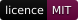
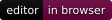
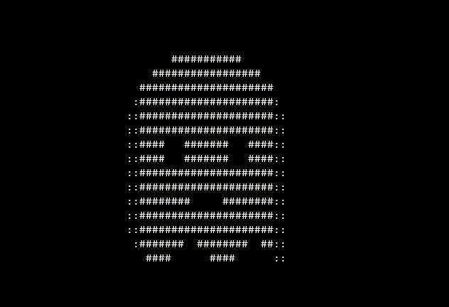

# ApollinairesASCII

[](https://github.com/EquityBot/ApollinaireASCII/actions/workflows/checks.yml) [](LICENSE.md) [](https://equitybot.github.io/ApollinaireASCII/)



<sub>A preview of `apollinaire animate ghost`. The tools themselves output text, never images.</sub>

Static art, block letters and animated scenes made of real, selectable ASCII characters. The `apollinaires-ascii` Rust library and CLI share their rendering and validation code with the browser editor.

[Open the browser editor](https://equitybot.github.io/ApollinaireASCII/) · [CLI guide](docs/CLI.md) · [Library example](examples/library.rs) · [Research and provenance](docs/RESEARCH.md)

```text
       .-.
      (o o)
      | O \
       \   \
        '~~~'
```

Every frame contains bytes 32 through 126. Line feeds separate rows when saved as text. The browser displays artwork in a `<pre>` using `textContent`. There are no image, SVG, canvas, Braille or Unicode block artwork outputs. Image and video files and the browser camera are accepted as conversion inputs.

## What it does

| Area | Included |
| --- | --- |
| Static art | 89 original pieces in 7 categories (animals, nature, objects, characters, borders and dividers, emoticons, banners), searchable by name or tag; blank canvases, character editing, borders, crops, flips and clipped composition |
| Lettering | Standard, small, big, slant, block and outline styles; multiline text; alignment; plain FIGlet `.flf` import |
| Animation | Ghost, rotating donut, wave, starfield, rain, fire, text reveal and scrolling text; deterministic seeds |
| Text effects | Reveal, typewriter, decrypt, scatter, wipes in 4 directions, rain, wave and burn, applied to any art or lettering, forwards or in reverse; set duration, FPS and seed |
| Media conversion | PNG, JPEG, GIF, WebP, BMP and PNM input; animated GIF timing; custom character ramps, aspect correction, transparency, inversion, gamma, contrast, dithering and edges; CLI batches and `https://` URLs |
| Video and camera | In the browser editor: any video the browser plays, sampled at 1 to 60 frames per second between chosen start and end times; a live text preview from the camera and timed recordings of 1 to 60 seconds |
| Browser editor | Pencil, eraser, line, rectangle, fill, typing and area select/move/copy/paste on the character grid, each usable by keyboard; diagram mode for joined `+-|` boxes, labels and arrows; onion skin; select/copy text, timeline, per-frame timing, frame insertion/duplication/deletion/reordering, undo/redo and local file imports |
| Export | Plain `.txt`, timed `.json` projects and standalone `.html` text players |
| Native playback | Terminal playback with cursor movement; saved artwork remains plain text |

All maintained application logic is Rust, including the browser's DOM controls and file handling. HTML and CSS describe the interface. A small JavaScript loader starts WebAssembly; standalone HTML exports include a small JavaScript text player so each file works on its own.

## Run the CLI

Download the archive for your platform from [Releases](https://github.com/EquityBot/ApollinaireASCII/releases/latest): Windows, macOS and Linux on x86-64 and ARM64, with `SHA256SUMS.txt`. Unpack it and put `apollinaire` on your `PATH`.

From v0.3.0, each archive has a signed build provenance attestation. To confirm an archive was built by this repository's release workflow from its release tag, run:

```sh
gh attestation verify apollinaire-v0.3.0-x86_64-unknown-linux-musl.tar.gz \
  --repo EquityBot/ApollinaireASCII \
  --signer-workflow EquityBot/ApollinaireASCII/.github/workflows/release.yml \
  --source-ref refs/tags/v0.3.0
```

To build from source instead, install [Rust](https://www.rust-lang.org/tools/install), then:

```sh
cargo install --locked --git https://github.com/EquityBot/ApollinaireASCII
```

```sh
apollinaire art ghost
apollinaire list --tag bird
apollinaire text "RUST" --font block
apollinaire animate ghost --output ghost.json
apollinaire text "HELLO" --font block | apollinaire effect decrypt - --output hello.json
apollinaire play ghost.json
apollinaire image photo.png --width 80 --dither --output photo.txt
apollinaire image a.png b.gif https://example.com/c.png --width 72 --output-dir ascii
apollinaire import ghost.json --format html --output ghost.html
```

The checked toolchain is pinned in `rust-toolchain.toml`. Existing output files are never overwritten. Static artwork defaults to text; animations default to JSON so frames and timings are retained. Use `--format text --frame 0` to deliberately select one animated frame.

## Use the library

The library has no browser or CLI dependency when default features are disabled:

```toml
[dependencies]
apollinaires-ascii = { git = "https://github.com/EquityBot/ApollinaireASCII", default-features = false }

[patch.crates-io]
gif = { git = "https://github.com/image-rs/image-gif", rev = "e60e4dd7708cc50f9371185cefa04273f410f116" }
```

Include the patch in your application's workspace root whilst the upstream GIF fix awaits a stable release. Cargo does not inherit a dependency's patch section. The CLI and browser builds in this repository already apply it. See [dependency notes](docs/DEPENDENCIES.md).

```rust
use apollinaires_ascii::{Animation, Canvas, SceneOptions, animation};

fn main() -> Result<(), String> {
    let mut canvas = Canvas::new(24, 6)?;
    canvas.rectangle(0, 0, 24, 6, b'#')?;
    canvas.text(3, 2, "HELLO, FRIEND")?;
    let still = Animation::still(canvas.finish());
    println!("{}", still.frames()[0].frame.text());

    let moving = animation::generate("ghost", &SceneOptions::default())?;
    let round_trip = Animation::from_json(&moving.to_json())?;
    assert_eq!(moving, round_trip);
    Ok(())
}
```

`Frame` is an immutable rectangular ASCII grid. `Canvas` provides validated, clipped drawing, including flood fill and diagram boxes and arrows that join with `+`; `Animation` owns equal-size frames, durations and loop behaviour. See [the format and limits](docs/FORMAT.md) and run `cargo doc --no-deps --open` for the API.

## Build the browser editor

```sh
cargo build --locked --release --target wasm32-unknown-unknown --no-default-features --features web
cargo install --locked wasm-bindgen-cli --version 0.2.130
wasm-bindgen target/wasm32-unknown-unknown/release/apollinaires_ascii.wasm --target web --out-dir web/pkg --out-name apollinaires_ascii
```

Serve `web/` with a local HTTP server and open its URL. Opening `index.html` directly as a `file:` URL cannot load its WebAssembly module. GitHub Actions builds and deploys the same directory to GitHub Pages.

The editor processes files in your browser. It has no upload endpoint, account system, analytics or external font request. The camera is requested only when you choose Camera on, and every camera track stops when you turn it off, finish a recording or hide or leave the page. Camera frames are never sent over the network. The library and editor make no network requests; only the CLI downloads, and only an `https://` image URL you pass to `apollinaire image`. Playback starts paused when reduced motion is requested and pauses when the page is hidden. Save JSON to keep all frames and their timings; text export saves the selected frame.

## Checks

```sh
cargo fmt --all --check
cargo clippy --locked --all-targets -- -D warnings
cargo test --locked
cargo build --locked --release
cargo clippy --locked --target wasm32-unknown-unknown --no-default-features --features web --lib --tests -- -D warnings
cargo test-editor
```

The integration tests cover the ASCII contract, whitespace, drawing, all bundled styles, scenes, effects and catalogue pieces, timing, round trips, malformed fonts, GIF preflight checks, video and camera frame sampling and timing, resource limits, script-safe HTML, CLI file handling and batch output, and URL limits against a local test server. `cargo test-editor` runs the editor tests in `src/web/tests.rs` in a headless browser. They embed the page markup and stylesheet, start the editor and drive it through pointer, keyboard, clipboard and form events: each drawing tool by pointer and by keyboard, diagram joins, onion skin, undo and redo, file opening, frame editing, effects and catalogue search, with every read of the artwork checked as printable ASCII. They need `wasm-bindgen-test-runner` from the pinned `wasm-bindgen-cli` 0.2.130 and `CHROMEDRIVER` set to a chromedriver matching an installed Chrome or Chromium. CI runs the native checks on Linux and Windows, runs the editor tests in headless Chrome on Linux and builds the browser module. See [validation](docs/VALIDATION.md) for the browser checks and known limits.

## Foundation and licence

ApollinairesASCII retains the history of [orhnk/RASCII](https://github.com/orhnk/RASCII), starting at `8d33a3670e51298d530ab202090b212501310cdd`. Its MIT image-conversion approach is the foundation of the converter. The shared frame model, drawing, scenes, project format, editor and exporters are new Rust code. It is an evolution of a focused converter, not a claim that upstream supplied this whole toolkit.

[Research](docs/RESEARCH.md) records 1,164 discovered repositories across 27 multilingual searches, the shortlist and why this foundation was selected. Discovery metadata is not a source audit of every result. No Ghostty animation artwork was copied.

MIT for this repository's code. Preserve the [licence](LICENSE.md) and [third-party notices](THIRD_PARTY_NOTICES.md). Dependencies and bundled font data retain their own licences and notices.

Hello, friend. Keep it in characters.
